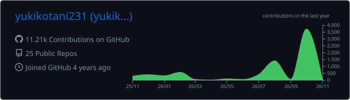
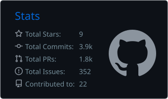
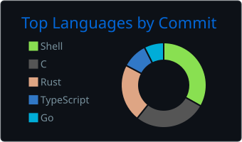

# Hi, I'm Yuki Kotani 👋

Software engineer who likes building things from the ground up — languages, OSes, developer tools, and fast backends.

- 🛠️ Building my own programming language and OS from scratch
- 🔍 Making developer tools: static analyzers and terminal UIs
- ⚡ Performance tuning (ISUCON)
- 🧠 Hacking on ML: low-bit networks, distillation, diffusion fine-tuning
- 🎛️ Audio software on the side (DAW, plugins)

## 🚀 Featured Projects

| Project | Description | Tech |
| --- | --- | --- |
| [**sqlsift**](https://github.com/yukikotani231/sqlsift) | SQL static analyzer that validates queries against schema definitions without a database connection | Rust |
| [**gh-pr-review**](https://github.com/yukikotani231/gh-pr-review) | TUI PR reviewer for GitHub: review files, mark them as viewed, and submit reviews from your terminal | Go |
| [**bastiolang**](https://github.com/yukikotani231/bastiolang) / [**bastios**](https://github.com/yukikotani231/bastios) | A homemade programming language and operating system | Rust / C |
| [**bitnet-triton**](https://github.com/yukikotani231/bitnet-triton) | High-performance Triton kernels for BitNet (1.58-bit) neural networks | Python / Triton |
| [**floorplan-set-transformer**](https://github.com/yukikotani231/floorplan-set-transformer) | Set Transformer for panoptic symbol spotting on FloorPlanCAD | Python / PyTorch |

## 🧰 Tech Stack

 

## 📊 GitHub Stats

  

  
  

## 🔗 Links

- 🌐 Website: [yukikotani231.github.io](https://yukikotani231.github.io)
