## yukikotani231

最近作っているもの

- [sqlsift](https://github.com/yukikotani231/sqlsift) - DBにつながずにSQLをスキーマ定義と突き合わせてチェックするツール (Rust)
- [gh-pr-review](https://github.com/yukikotani231/gh-pr-review) - ターミナルでPRレビューするTUI (Go)
- [bastiolang](https://github.com/yukikotani231/bastiolang) / [bastios](https://github.com/yukikotani231/bastios) - 自作言語と自作OS
- [bitnet-triton](https://github.com/yukikotani231/bitnet-triton) - BitNet用のTritonカーネル

あとISUCONの練習をしたり、機械学習やオーディオまわりで遊んだりしています。

よく書く言語: Rust / Go / TypeScript / Python

<picture>
  <source media="(prefers-color-scheme: dark)" srcset="cards/stats-dark.svg">
  
</picture>
<picture>
  <source media="(prefers-color-scheme: dark)" srcset="cards/languages-dark.svg">
  
</picture>

<picture>
  <source media="(prefers-color-scheme: dark)" srcset="cards/activity-dark.svg">
  
</picture>

[yukikotani231.github.io](https://yukikotani231.github.io)
